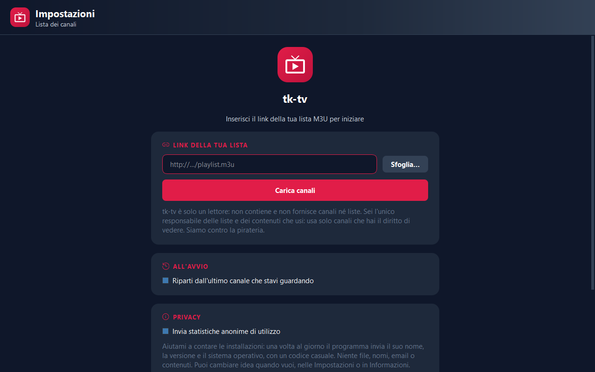

<!-- README generato da Dropbox/CLAUDE/dev/agpl-rollout/readme/genera_readme.py: modificare lì -->
<div align="center">


# tk-tv

### La tua lista M3U, comoda come un telecomando.

Canali divisi per gruppo, loghi, ricerca e preferiti, con il motore video di VLC già incluso.

<a href="COPYING"></a>    

<br>

<a href="https://pietrodefilippis.it/software/"></a> &nbsp; <a href="https://pietrodefilippis.it/donazione/"></a>

<br><br>



</div>

---

## ✨ Cosa fa

<table>
<tr>
<td width="50%" valign="top">

### 📺&nbsp; Canali in ordine
Gruppi, loghi e numeri canale: cambi canale con le frecce o scrivendo il numero, come in TV.

</td>
<td width="50%" valign="top">

### 🔎&nbsp; Cerca e preferiti
Trovi un canale scrivendo poche lettere e tieni a portata di mano quelli che guardi di più.

</td>
</tr>
<tr>
<td width="50%" valign="top">

### ⏯️&nbsp; Motore VLC incluso
Riproduce i flussi http, HLS, DASH, UDP e RTSP: non devi installare nient'altro.

</td>
<td width="50%" valign="top">

### 🌙&nbsp; Timer e audio
Timer di spegnimento, scelta della lingua dell'audio e ripartenza dall'ultimo canale guardato.

</td>
</tr>
<tr>
<td width="50%" valign="top">

### 🖥️&nbsp; Schermo intero
Doppio clic sul video per guardarlo a schermo intero.

</td>
<td width="50%" valign="top">

### 🛡️&nbsp; Sicuro
La lista può aprire solo indirizzi web e di streaming: niente file locali né risorse della rete di casa.

</td>
</tr>
</table>

## 🔒 I tuoi dati

tk-tv non contiene e non suggerisce liste di canali: usa solo quella che indichi tu, e il link resta sul tuo computer.

> ⚖️ **tk-tv è solo un lettore.** Non contiene e non fornisce canali né liste: chi lo usa è l'unico responsabile delle liste e dei contenuti che apre, e deve usare solo canali che ha il diritto di vedere. **Siamo contro la pirateria.**

| Resta sul tuo computer | Va in rete (e perché) |
|---|---|
| Il link della tua lista | I canali e i loghi della tua lista |
| Preferiti e impostazioni | Controllo degli aggiornamenti su pietrodefilippis.it |
| L'ultimo canale guardato | Statistiche anonime, solo se le accetti |

Nessuna pubblicità, nessun account da creare. Le statistiche anonime partono **solo se le accetti** al primo avvio
(si cambiano quando vuoi). Gli aggiornamenti sono **firmati digitalmente**: il programma installa solo quelli
pubblicati dall'autore.

## 📥 Installazione

- **Windows 10 / 11** — scarica lo ZIP o l'installer, estrai e avvia. Non servono i permessi di amministratore.
- **macOS** (Intel o Apple Silicon) — apri il `.dmg` e trascina l'app in *Applicazioni*. Al primo avvio: clic destro sull'app → *Apri*.

Gli aggiornamenti arrivano da soli: quando esce una versione nuova il programma te lo propone.

<details>
<summary><b>🛠️ Avviarlo dal codice sorgente</b></summary>

<br>

Serve **Python 3.13**.

```bash
python -m venv .venv
.venv\Scripts\python -m pip install "pyside6-essentials==6.11.*" python-vlc certifi
```

libVLC: estrai lo ZIP ufficiale di **VLC 3.0.24** per Windows 64 bit in `vendor\vlc-3.0.24` (su macOS lo prende `mac/build_mac.sh` dal dmg ufficiale), poi `.venv\Scripts\python run.py`.

Prove senza rete: `python -m unittest tests.test_sicurezza`. Pacchetti: `installer\build.ps1` (Windows), `mac/build_mac.sh` (macOS).

</details>

## 📜 Licenza

**tk-tv** è software libero: © 2026 Pietro De Filippis (TecnikGeek), licenza
**[GNU Affero General Public License v3.0](COPYING)** o successiva. Puoi usarlo, studiarlo, modificarlo e
condividerlo; è fornito **così com'è, senza alcuna garanzia**. I testi delle licenze dei componenti inclusi
(VLC/libVLC, python-vlc, Qt/PySide6, Python, certifi) sono nella cartella [`licenze/`](licenze/) e nel programma, in *Informazioni → Licenze e codice
sorgente*.

> Il nome **tk-tv** e il logo non sono coperti dalla licenza (AGPL, sezione 7): una versione modificata deve
> avere un nome e un logo diversi.

---

<div align="center">

**Ti è utile?** Tutte le funzioni sono gratis per tutti. Se vuoi, un caffè aiuta a migliorarlo e a crearne altri.

<a href="https://pietrodefilippis.it/donazione/"></a>

<sub>Creato da <a href="https://pietrodefilippis.it">Pietro De Filippis · TecnikGeek</a> — Webmaster & UX/UI Designer</sub>

</div>
